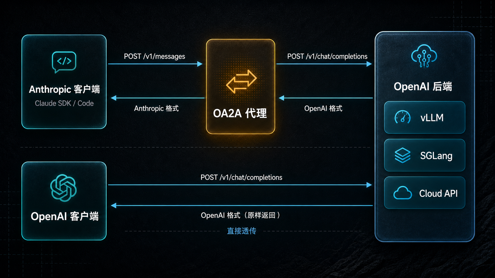

# cc-convert

[](https://www.python.org/downloads/)
[](https://opensource.org/licenses/Apache-2.0)
[](https://pypi.org/project/cc-convert/)

**[English](README.md) | 中文**

一个轻量级代理，带有多实例管理面板

---

### 为什么选择 CC Convert

- **双向协议转换** — Anthropic Messages API ↔ OpenAI Chat Completions API，让 Claude SDK / Claude Code 无缝对接 vLLM、SGLang 等任意 OpenAI 后端
- **OpenAI 原生透传** — 同时提供 `POST /v1/chat/completions` 端点，请求原样转发，零转换损耗，保留所有上游字段
- **OpenAI Responses API 桥接** — `POST /v1/responses` 接收 Responses API 格式请求，转换为 `/v1/chat/completions` 发给只实现 chat completions 的后端，让 Responses SDK 客户端也能对接 vLLM/SGLang
- **服务端 Web Search** — 内置 Tavily / 通晓 搜索引擎，任何模型都能获得联网能力，无需客户端改造（Anthropic 与 Responses 端点均支持）
- **交错思考 (Interleaved Thinking)** — 完整支持 `thinking` 推理块，配合 `chat_template_kwargs` 和 `reasoning_effort`，DeepSeek V4 等推理模型开箱即用
- **流式 & 工具调用 & 视觉** — SSE 实时流式、Claude tool_use 转换、多模态图像输入，覆盖核心 API 能力
- **模型名映射** — 通配符规则将 Anthropic 模型名自动映射到后端模型，告别手动改配置
- **守护进程 + Web 面板** — `ccconvert start/stop/logs` 一键管理，内置 Web 仪表盘监控请求统计

---

## 工作原理

三种运行模式：

| 模式 | 端点 | 适用场景 |
|------|----------|----------|
| **Anthropic 代理** | `POST /v1/messages` | Claude SDK / Claude Code 应用对接任意 OpenAI 后端 |
| **OpenAI 透传** | `POST /v1/chat/completions` | OpenAI 原生客户端直接透传，无转换开销 |
| **Responses 桥接** | `POST /v1/responses` | OpenAI Responses SDK 客户端对接只支持 chat completions 的后端 |



---

## 快速开始

```bash
pip install cc-convert
ccconvert start
# 面板打开在 http://127.0.0.1:<auto-port>
```

### Docker

```bash
docker run -d --name ccconvert -p 8080:8080 \
  -e CCCONVERT_OPENAI_API_KEY=your-key \
  -e CCCONVERT_OPENAI_BASE_URL=http://host.docker.internal:8000/v1 \
  cc-convert/cc-convert:latest
```

> Docker 中运行多实例需使用 `--net=host` 或为每个实例端口添加 `-p <port>:<port>` 映射。

### 使用示例

```python
import anthropic

client = anthropic.Anthropic(base_url="http://localhost:8080", api_key="any")

message = client.messages.create(
    model="your-model",
    max_tokens=1024,
    messages=[{"role": "user", "content": "你好！"}],
)
print(message.content[0].text)
```

---

## 多实例设置

为不同的 Claude Code 窗口或项目运行多个独立代理实例。

1. 打开管理面板（运行 `ccconvert start`，访问显示的 URL）
2. 点击 **添加实例**
3. 填写配置：
   - **名称** — 实例的友好标识
   - **端口** — 自动建议，可按需修改
   - **上游基础 URL** — 后端端点地址（例如 `http://localhost:8000/v1`）
   - **上游 API 密钥** — 后端 API 密钥
   - **目标模型** — 要使用的模型名称
4. 点击 **保存**，然后点击 **启动**
5. 每个运行中的实例拥有独立端口 — 不同 Claude Code 窗口使用不同端口
6. 从实例卡片复制环境变量代码段：

   **PowerShell:**
   ```powershell
   $env:ANTHROPIC_BASE_URL="http://127.0.0.1:<port>"; $env:ANTHROPIC_AUTH_TOKEN="local"; claude
   ```

   **Bash:**
   ```bash
   export ANTHROPIC_BASE_URL=http://127.0.0.1:<port> && export ANTHROPIC_AUTH_TOKEN=local && claude
   ```

   **CMD:**
   ```cmd
   set ANTHROPIC_BASE_URL=http://127.0.0.1:<port> && set ANTHROPIC_AUTH_TOKEN=local && claude
   ```

---

## CLI 参考

```bash
ccconvert start              # 后台启动管理器
ccconvert stop               # 停止管理器
ccconvert restart            # 重启管理器
ccconvert status             # 查看运行状态
ccconvert logs               # 查看最近日志
ccconvert logs -f            # 实时跟踪日志
ccconvert open               # 在浏览器中打开管理面板
```

直接运行 `ccconvert` 不带参数可查看完整帮助信息。

---

## 配置

配置文件：`~/.ccconvert/config.toml`（首次运行自动创建）

配置采用 `[manager]` 设置全局面板参数，`[[instances]]` 定义每个代理实例。你也可以通过 Web 面板管理实例 —— 配置文件会自动写入。

### 管理器

| 选项 | 必需 | 默认值 | 说明 |
|--------|----------|---------|-------------|
| `host` | 否 | `0.0.0.0` | 面板绑定地址 |
| `port` | 否 | `0` | 面板端口（`0` = 自动分配） |
| `log_level` | 否 | `INFO` | `DEBUG`、`INFO`、`WARNING`、`ERROR` |

### 实例

每个 `[[instances]]` 块定义一个独立代理：

| 选项 | 必需 | 默认值 | 说明 |
|--------|----------|---------|-------------|
| `name` | 否 | `"default"` | 实例标识 |
| `port` | 是 | — | 代理监听端口 |
| `openai_api_key` | 是 | — | 上游后端 API 密钥 |
| `openai_base_url` | 是 | `https://api.openai.com/v1` | 上游后端 URL |
| `openai_org_id` | 否 | — | OpenAI 组织 ID |
| `openai_project_id` | 否 | — | OpenAI 项目 ID |
| `api_key` | 否 | — | 代理认证密钥（Bearer token） |
| `default_model` | 否 | — | 默认模型名称 |
| `request_timeout` | 否 | `300.0` | 上游请求超时时间（秒） |

### 实例级模型名称映射

每个实例可拥有独立的模型映射规则，支持通配符：

```toml
[[instances]]
name = "my-instance"
# ... 其他配置 ...

[[instances.model_mapping]]
from = "sonnet"
to = "kimi-k2.5"

[[instances.model_mapping]]
from = "*opus*"
to = "deepseek-v4"
```

`from` 支持 `*` 和 `?` 通配符。`default_model` 是无匹配规则时的默认值。

### 网络搜索

全局搜索提供商配置，所有实例共享。支持 [Tavily](https://tavily.com) 和 [通晓](https://www.aliyun.com/product/tongxiao)。

```toml
tavily_api_key = "tvly-xxx"
tongxiao_api_key = "xxx"
websearch_provider = "tavily"       # "tavily"、"tongxiao" 或 "both"
websearch_max_uses = 5
tavily_max_results = 5
tongxiao_max_results = 5
```

### CORS

全局 CORS 设置，所有实例共享：

```toml
cors_origins = ["*"]
cors_credentials = true
cors_methods = ["*"]
cors_headers = ["*"]
```

---

## API 端点

### Anthropic 兼容

| 方法 | 路径 | 说明 |
|--------|------|-------------|
| `POST` | `/v1/messages` | 创建消息（通过 `stream: true` 支持流式） |
| `GET` | `/v1/models` | 列出可用模型（代理转发） |
| `POST` | `/v1/messages/count_tokens` | Token 计数（本地 tiktoken 估算） |
| `GET` | `/health` | 健康检查 |

### OpenAI 原生透传

| 方法 | 路径 | 说明 |
|--------|------|-------------|
| `POST` | `/v1/chat/completions` | OpenAI 格式对话补全（支持流式和非流式） |

透传端点将请求原样转发到上游 —— 无校验、无转换、无模型名映射。所有字段（包括 `chat_template_kwargs`、`reasoning_effort` 等）均保持原样。

### OpenAI Responses API 桥接

| 方法 | 路径 | 说明 |
|--------|------|-------------|
| `POST` | `/v1/responses` | Responses API 格式请求，转换为上游 chat/completions |

接收 Responses API 格式请求（`input`、`instructions`、`reasoning.effort`、`function` 类型 `tools`、`max_output_tokens` 等），转换为 `/v1/chat/completions` 调用上游后端，再将上游响应转回 Responses `Response` 对象。流式和非流式都支持 —— 流式输出完整的 Responses SSE 事件序列（`response.created` → `response.output_text.delta` → `response.completed`）。

**服务端联网搜索**：请求携带 `web_search` / `web_search_preview` 工具且配置了搜索提供商（Tavily 或通晓）时，代理在本地运行搜索循环。`web_search` 工具以函数工具形式暴露给模型，模型调用时通过配置的提供商执行，结果回填供模型基于最新信息作答。Responses 输出中每个执行的搜索对应一个 `web_search_call` 条目。配置方式与 Anthropic 路径相同：

```toml
tavily_api_key = "tvly-xxx"
# 或
tongxiao_api_key = "xxx"
websearch_provider = "tavily"       # "tavily"、"tongxiao" 或 "both"
websearch_max_uses = 5
```

```python
from openai import OpenAI

client = OpenAI(base_url="http://localhost:8080/v1", api_key="any")
resp = client.responses.create(
    model="your-model",
    input="你好！",
    instructions="回答简短",
)
print(resp.output_text)
```

---

## 功能特性

- **流式响应** — Anthropic 和 OpenAI 两种模式均支持 SSE 实时流式输出
- **工具调用** — Claude 兼容的工具调用（`tool_use` / `tool_result`）转换为 OpenAI 函数调用
- **视觉模型** — 通过 `image_url` 内容块支持多模态图像输入
- **思考/推理** — 支持 `thinking` 块，配合 `chat_template_kwargs`（vLLM/SGLang）以及 DeepSeek V4 的 `output_config.effort` 到 `reasoning_effort` 映射
- **网络搜索** — 通过 Tavily 或通晓进行服务端网页搜索，适用于任何模型
- **模型映射** — 基于通配符的模型名称解析
- **API 认证** — 代理本身支持可选的 Bearer token 认证
- **Web 控制台** — 内置 Web 界面 `/`，用于监控请求统计
- **守护进程模式** — 后台服务管理（启动/停止/重启/状态/日志）

---

## 配合 Claude Code 使用

### Docker（推荐）

仓库中已包含预配置好 CC Convert 代理和 Claude Code 的 `docker-compose.yml`：

```bash
cat > .env << 'EOF'
CCCONVERT_OPENAI_API_KEY=your-api-key
CCCONVERT_OPENAI_BASE_URL=http://host.docker.internal:8000/v1
CLAUDE_MODEL=your-model-name
EOF

docker-compose up -d
docker-compose exec claude-code claude --dangerously-skip-permissions
```

> Docker 中运行多实例需使用 `--net=host` 或为每个实例端口添加端口映射。

### 本地安装

配置 `~/.claude/settings.json`：

```json
{
  "env": {
    "ANTHROPIC_BASE_URL": "http://localhost:8080",
    "ANTHROPIC_API_KEY": "any",
    "ANTHROPIC_MODEL": "your-model",
    "ANTHROPIC_DEFAULT_SONNET_MODEL": "your-model",
    "ANTHROPIC_DEFAULT_OPUS_MODEL": "your-model",
    "ANTHROPIC_DEFAULT_HAIKU_MODEL": "your-model"
  }
}
```

然后启动代理（`ccconvert start`）并运行 Claude Code（`claude`）。

---

## 支持的后端

| 后端 | 状态 |
|---------|--------|
| [vLLM](https://github.com/vllm-project/vllm) | 完全支持 |
| [SGLang](https://github.com/sgl-project/sglang) | 完全支持 |
| 任意 OpenAI 兼容 API | 应可正常使用 |

> Ollama 原生支持 Anthropic API 格式 —— 直接将 Claude SDK 指向 `http://localhost:11434/v1` 即可，无需代理。

---

## 开发

```bash
git clone https://github.com/cc-convert/cc-convert.git
cd cc-convert
pip install -e ".[dev]"

pytest                           # 445+ 测试, >80% 覆盖率
```

---

## 许可证

Apache License 2.0
